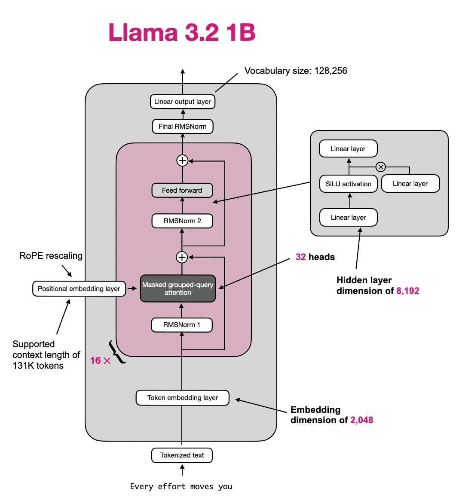
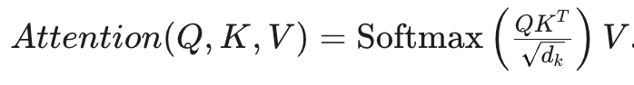

<div style="padding: 1em; background: #eee">
This post was originally published at <a href="https://www.javaadvent.com/2025/12/a-glance-at-gpu-goodness-in-java-llm-inference-with-tornadovm.html">JVM Advent</a>.
</div>


It seems like it’s become a tradition that I announce I have joined a new company for the Java Advent of Code. At least this time it’s actually an old friend: I am excited to be back at Red Hat, in the [llm-d](https://llm-d.ai/) team! Does that mean I forgot about Java? Of course not. If anything, this is an opportunity to learn more about GPU programming, and since Java is my comfort-zone language, what better occasion than looking into [TornadoVM](https://www.tornadovm.org/)?

Recently, the TornadoVM team released [gpullama3](https://www.tornadovm.org/gpullama3), a proof-of-concept demonstrating LLM inference on GPUs using pure Java. Let’s explore this together!

## What is TornadoVM?

[TornadoVM](https://www.tornadovm.org/) is a plugin for the OpenJDK that enables Java programs to automatically run on heterogeneous hardware (GPUs, FPGAs, and multi-core CPUs) using standard Java code annotated for parallel compute.

Under the hood, TornadoVM:

1.  takes your Java bytecode
2.  compiles it to GPU-specific kernels (via OpenCL, PTX, or SPIR-V)
3.  manages data transfers between CPU and GPU memory
4.  executes the computation on the GPU
5.  returns the results back to your Java program

Transformer-based language models are computationally expensive but highly-parallelizable. At inference time, generating each token requires matrix multiplications across billions of parameters. GPUs excel at these operations because they can perform thousands of computations in parallel. Thus, TornadoVM is the perfect tool for this kind of workload.

# Installing TornadoVM

Installing `GPULlama3.java` was surprisingly straightforward. Make sure you have your favorite flavor of JDK 21 installed. I use `sdkman`, so I made sure I had [Temurin 21](https://adoptium.net/temurin/releases) installed:

```text
sdk install java 21.0.9-tem
```

Then you’ll want to make sure you have installed `cmake`, a C/C++ toolchain, Python and `pip`. Now you can clone the repo:

```text
git clone https://github.com/beehive-lab/GPULlama3.java
```

and follow the instructions on the [README](https://github.com/beehive-lab/GPULlama3.java?tab=readme-ov-file#install-build-and-run); for instance, on macOS/Linux:

```text
# Enter the TornadoVM submodule directory
cd external/tornadovm

# Optional: Create and activate a Python virtual environment if needed
python3 -m venv venv
source ./venv/bin/activate

# Install TornadoVM with a supported JDK 21 and select the backends (--backend opencl,ptx).
# To see the compatible JDKs run: ./bin/tornadovm-installer --listJDKs
# For example, to install with OpenJDK 21 and build the OpenCL backend, run:
./bin/tornadovm-installer --jdk jdk21 --backend opencl

# Source the TornadoVM environment variables
source setvars.sh
```

You can verify the installation was successful by running one example:

```bash
cd tornado-examples
mvn package
cd ..
tornado -cp tornado-examples/target/tornado-examples-1.1.2-dev-e1d2d12.jar uk.ac.manchester.tornado.examples.compute.MatrixVectorRowMajor
```

Of course, make sure you replace `tornado-examples-1.1.2-dev-e1d2d12.jar` with the right jar name! Your output should look something like this:

```text
WARNING: Using incubator modules: jdk.incubator.vector
Matrix-Vector Multiplication Benchmark
======================================
Configuration:
- Input dimension (columns): 8192
- Output dimension (rows): 2048
- Local work group size: 32
- Backend: OPENCL
- DP4A benchmarks enabled: false
- Warmup iterations: 140
- Benchmark iterations: 120

Initializing data...
Setting up TornadoVM execution...
Warming up sequential implementation...
Benchmarking sequential implementation...
Warming up parallel implementation...
Benchmarking parallel implementation...
Validating results...
Validation PASSED ✓

Performance Results:
====================
Matrix size: 2048 x 8192
Sequential Implementation:
  Average time: 15.892 ms
  Min time: 15.673 ms
  Max time: 16.795 ms
  Performance: 2.11 GFLOP/s
Parallel Implementation (TornadoVM):
  Average time: 2.405 ms
  Min time: 2.030 ms
  Max time: 5.069 ms
  Performance: 13.95 GFLOP/s
Pure TornadoVM @Parallel Implementation (TornadoVM):
  Average time: 4.931 ms
  Min time: 3.745 ms
  Max time: 8.357 ms
  Performance: 6.81 GFLOP/s
Parallel Implementation FP16 (TornadoVM):
  Average time: 1.840 ms
  Min time: 1.575 ms
  Max time: 3.090 ms
  Performance: 18.24 GFLOP/s
Q8 Vectorized:
  Average time: 1.746 ms
  Min time: 1.459 ms
  Max time: 6.097 ms
  Performance: 19.22 GFLOP/s

Speedup: KernelContext vs Java 6.61x
Speedup: @Parallel vs Java 3.22x
Speedup: KernelContext vs @Parallel 2.05x
Speedup: Q8 Vectorized vs KernelContext 1.38x
Speedup: Q8 Vectorized vs KernelContext FP16 1.05x
```

# Baby’s First GPU Kernel

Here’s a simple `Example.java`:

```java
import uk.ac.manchester.tornado.api.annotations.*;
import uk.ac.manchester.tornado.api.*;
import uk.ac.manchester.tornado.api.enums.DataTransferMode;
import uk.ac.manchester.tornado.api.types.arrays.FloatArray;

public class Example {

    public static void vectorMul(FloatArray a, FloatArray b, FloatArray result) {
        for (@Parallel int i = 0; i < result.getSize(); i++) {
            result.set(i, a.get(i) * b.get(i));
        }
    }

    public static void main(String... args) {
        int size = 1024;

        var a = new FloatArray(size);
        var b = new FloatArray(size);
        var result = new FloatArray(size);

        for (int i = 0; i < size; i++) {
            a.set(i, i * 2.0f);
            b.set(i, i + 1.0f);
        }

        var taskGraph = new TaskGraph("multiply")
            .transferToDevice(DataTransferMode.FIRST_EXECUTION, a, b)
            .task("vectorMul", Example::vectorMul, a, b, result)
            .transferToHost(DataTransferMode.EVERY_EXECUTION, result);

        var snapshot = taskGraph.snapshot();
        new TornadoExecutionPlan(snapshot).execute();

        System.out.println("\nVector Multiplication Results (first 10):");
        for (int i = 0; i < 10; i++) {
            System.out.printf("result[%d] = %.2f (a[%d]=%.2f * b[%d]=%.2f)\n",
                i, result.get(i), i, a.get(i), i, b.get(i));
        }
    }
}
```

The `@Parallel` annotation tells TornadoVM this loop can be parallelized. The `TaskGraph` API manages data movement and execution scheduling. You can compile it with the following (if you followed the installation guide correctly `$TORNADO_SDK` will point to the right path):

```text
javac -g --enable-preview -source 21 -cp "$TORNADO_SDK/share/java/tornado/*" Example.java
```

Notice that `-g` is required for this to work correctly. Now you can run it with:

```text
tornado Example
```

It will print the first 10 items in the resulting vector.

## Playing with **GPULlama3**.java

The [gpullama3](https://www.tornadovm.org/gpullama3) project demonstrates running a Llama 3 model entirely in Java with GPU acceleration. Assuming you are back at the root of the repo, continue with the setup procedure.

```text
# Navigate back to the project root directory
cd ../../

# Source the project-specific environment paths -&gt; this will ensure the correct paths are set for the project and the TornadoVM SDK
# Expect to see: [INFO] Environment configured for Llama3 with TornadoVM at: /home/YOUR_PATH_TO_TORNADOVM
source set_paths

# Build the project using Maven (skip tests for faster build)
# mvn clean package -DskipTests or just make
make
```

Now let’s download a compatible model using the HuggingFace CLI:

```text
# download and install the hugging face CLI
pip install -U huggingface_hub

# download a model to ./models/
hf download beehive-lab/Llama-3.2-1B-Instruct-GGUF-FP16 --include '*.gguf' --local-dir models
```

Try it! Even on my poor MacBook Air with 8 GB RAM (provided I don’t have too many applications open) this returns:

```text
❯ python llama-tornado --gpu --verbose-init --opencl --model models/Llama-3.2-1B-Instruct-FP16.gguf --prompt "tell me a joke"
WARNING: Using incubator modules: jdk.incubator.vector
Loading model weights in TornadoVM format (loading F16)

Starting TornadoVM initialization...
TornadoVM GPU execution plan creation: 1011.56 ms
Java to GPU JIT compiler warmup: 4994.25 ms
Transfer read-only weights to GPU: 13958.97 ms
Finished TornadoVM initialization...

Here's one:

What do you call a fake noodle?

(wait for it...)

An impasta!

Hope that made you laugh!


achieved tok/s: 3.00. Tokens: 42, seconds: 13.98
```

Disclaimer: even if you have better CPU/GPUs at your disposal, they are unlikely to affect the quality of the joke.

# What just happened?

GPULlama3.java currently supports a few FP16 (16-bit floating point) and 8-bit quantized models:

- Llama 3.2 (1B) – FP16
- Llama 3.2 (3B) – FP16
- Llama 3 (8B) – FP16
- Mistral (7B) – FP16
- Qwen3 (0.6B) – FP16
- Qwen3 (1.7B) – FP16
- Qwen3 (4B) – FP16
- Qwen3 (8B) – FP16
- Phi-3-mini-4k – FP16
- Qwen2.5 (0.5B)
- Qwen2.5 (1.5B)
- DeepSeek-R1-Distill-Qwen (1.5B)

Depending on the model being selected, a different execution plan will be built. The execution plan corresponds to the model architecture. In our case, we picked the unquantized **Llama 3.2 1B FP16**. Let’s take a look at the `setupTornadoForwardPlan()` method in FP16LayerPlanner, used by LLama 3.2:

```java
abstract class FP16LayerPlanner ... {
    ...
    protected final void setupTornadoForwardPlan() {
        List<ImmutableTaskGraph> allTaskGraphs = new ArrayList<>();
        GridScheduler masterScheduler = new GridScheduler();

        // 1. Activation layer (common to all models)
        allTaskGraphs.add(activationLayer.getImmutableTaskGraph());
        activationLayer.updateGridScheduler(masterScheduler);

        // 2. FFN layers (N transformer layers - model-specific)
        allTaskGraphs.addAll(ffnLayers.getFfnLayerTaskGraphs());
        ffnLayers.updateGridScheduler(masterScheduler);

        // 3. Logits layer (common to all models)
        allTaskGraphs.add(logitsLayer.getTaskGraph().snapshot());
        logitsLayer.updateGridScheduler(masterScheduler);

        // Cache for future retrievals
        this.immutableTaskGraphs = allTaskGraphs;
        this.gridScheduler = masterScheduler;
    }

}
```

In the **Activation layer** we mostly look up token embeddings and apply an initial normalization step, while the **Logit layer** is where we convert the model’s internal representation into token predictions. So let’s concentrate a bit more on the **Feed-Forward Network layer** **(FFN)**, and in particular on the **Attention** implementation. The [`LlamaFP16FFNLayers#setupSingleFFNLayer` method](https://github.com/beehive-lab/GPULlama3.java/blob/0060fc66f30b8f023d84bc3bc5c031f26c262bae/src/main/java/org/beehive/gpullama3/tornadovm/layers/type/fp16/LlamaFP16FFNLayers.java#L99) is a bit cryptic at a first glance; let’st start from its signature:

```java
TaskGraph setupSingleFFNLayer(LlamaTornadoWeights weights, Configuration config, int layerIndex)
```

The method is building a `TaskGraph`, essentially describing the data flow of our GPU kernels. Let’s focus on QKV and attention, using [Sebastian Raschka](https://github.com/rasbt/LLMs-from-scratch/blob/main/ch05/07_gpt_to_llama/standalone-llama32.ipynb)[^1][‘s excellent Python Notebook as a reference](https://github.com/rasbt/LLMs-from-scratch/blob/main/ch05/07_gpt_to_llama/standalone-llama32.ipynb). The following is the architecture diagram of the Llama 3.2 1B model:

[](/assets/tornadovm/llama321b.png)

For obvious reasons of brevity, we aren’t going to explore this in detail, but we do want to take a look at the implementation of the [attention heads](https://en.wikipedia.org/wiki/Attention_(machine_learning)). In particular, let’s take a look at how we compute the Query, Key, Value matrices (`Q,K,V = project(x)` in the Python version):

```java
.task("qmatmul",
        TransformerComputeKernelsLayered::matrixVectorGeneric, context,
        state.wrapXb, state.wrapQ,
        weights.wqLayered[layerIndex].asHalfFloatArray(),
        config.dim(), config.dim(),
        LOCAL_WORK_GROUP_SIZE_ALLOC)
.task("kmatmul",
        TransformerComputeKernelsLayered::matrixVectorGeneric, context,
        state.wrapXb, state.wrapK,
        weights.wkLayered[layerIndex].asHalfFloatArray(),
        config.dim(), config.kvDim(),
        LOCAL_WORK_GROUP_SIZE_ALLOC)
.task("vmatmul",
        TransformerComputeKernelsLayered::matrixVectorGeneric, context,
        state.wrapXb, state.wrapV,
        weights.wvLayered[layerIndex].asHalfFloatArray(),
        config.dim(), config.kvDim(),
        LOCAL_WORK_GROUP_SIZE_ALLOC)
```

This is followed by the RoPE rescaling to encode token positions:

```java
.task("rope", TransformerComputeKernelsLayered::ropeRotation, context,
        state.positionHolder,
        state.wrapQ, state.wrapK,
        config.kvDim(),
        config.headSize())
```

Now we are ready to compute **attention.** The generic version (there is also an NVidia-specific implementation) is:

```java
unifiedLayer.task("parallel-attention", TransformerComputeKernelsLayered::processHeadsParallel,
        state.wrapQ, state.wrapKeyCache, state.wrapValueCache, state.wrapXb,
        config.numberOfHeads(), config.headSize(), config.kvDim(), config.kvMul(),
             config.contextLength(),
        state.positionHolder, state.wrapAtt,
        layerIndex, config.contextLength());
```

Let’s drill down into `TransformerComputeKernelsLayered::processHeadsParallel` to see how that is performed. The following is one of the GPU kernels. It essentially computes:

<div style="text-align: center">
    
</div>

You will notice that the method:

1.  takes the `Q,K` **(Query, Key) vectors** that we computed earlier and it computes the attention score up to the current position `pos` (scaled by the square root of the head size), filling the `wrapAtt` vector
2.  next, it applies `softmax` to the `wrapAtt`, turning the scores into attention weights (steps 2-4), accumulating partial results onto the same `wrapAtt` vector
3.  finally (step 5) it computes a weighted sum of the **Value vectors** (`value_cache`) up to `pos`, using the calculated **Attention Weights** (`wrapAtt`).

```java
/**
 * Computes attention for a single head. Implements scaled dot-product attention with softmax normalization.
 *
 * Steps: 1. Compute attention scores: Q·K / sqrt(head_size) 2. Apply softmax (with max subtraction for numerical stability) 3. Compute weighted sum of values
 *
 * @param allQ
 *         All query vectors
 * @param key_cache
 *         Cached keys
 * @param value_cache
 *         Cached values
 * @param allXb
 *         Output buffer
 * @param h
 *         Head index to process
 * @param headSize
 *         Dimension per head
 * @param kvDim
 *         Key/value dimension
 * @param kvMul
 *         Key multiplier for grouped attention
 * @param loff
 *         Layer offset in cache
 * @param pos
 *         Current position
 * @param wrapAtt
 *         Attention weights buffer
 */
private static void processHeadTornado(FloatArray allQ, FloatArray key_cache, FloatArray value_cache, FloatArray allXb, int h, int headSize, int kvDim, int kvMul, long loff, int pos,
        FloatArray wrapAtt) {

    // Base index for this head's attention weights
    int headOffset = h * (pos + 1);

    // STEP 1: Calculate attention scores for all timesteps
    for (int t = 0; t <= pos; t++) {
        int kvHeadIdx = h / kvMul;
        int keyOffset = (int) (loff + t * kvDim + kvHeadIdx * headSize);

        float score = 0.0f;
        for (int i = 0; i < headSize; i++) {
            score += allQ.get(h * headSize + i) * key_cache.get(keyOffset + i);
        }
        score = score / TornadoMath.sqrt(headSize);

        // Store in attention buffer
        wrapAtt.set(headOffset + t, score);
    }

    // STEP 2: Find max score for softmax stability
    float maxScore = wrapAtt.get(headOffset);
    for (int t = 1; t <= pos; t++) {
        float val = wrapAtt.get(headOffset + t);
        if (val > maxScore) {
            maxScore = val;
        }
    }

    // STEP 3: Compute exponentials and sum
    float sum = 0.0f;
    for (int t = 0; t <= pos; t++) {
        int idx = headOffset + t;
        float expScore = TornadoMath.exp(wrapAtt.get(idx) - maxScore);
        wrapAtt.set(idx, expScore);
        sum += expScore;
    }

    // STEP 4: Normalize
    float normFactor = (sum > 0.0f) ? (1.0f / sum) : (1.0f / (pos + 1));
    for (int t = 0; t <= pos; t++) {
        int idx = headOffset + t;
        wrapAtt.set(idx, wrapAtt.get(idx) * normFactor);
    }

    // STEP 5: Compute weighted sum of values for each dimension
    for (int i = 0; i < headSize; i++) {
        float weightedSum = 0.0f;
        for (int t = 0; t <= pos; t++) {
            int kvHeadIdx = h / kvMul;
            int valueOffset = (int) (loff + t * kvDim + kvHeadIdx * headSize);
            weightedSum += wrapAtt.get(headOffset + t) * value_cache.get(valueOffset + i);
        }
        allXb.set(h * headSize + i, weightedSum);
    }
}
```

After the attention mechanism computes relationships between tokens, the result is added to the original input, normalized, and passed through a feed-forward network. This process repeats across multiple layers before finally producing the next-token prediction (the *logit layer*).

Because it’s an *autoregressive* model, this entire process repeats for each token, using the previously generated sequence as input.

In short, TornadoVM handled GPU compilation and execution transparently, allowing a pure Java program to perform LLM inference!

# Conclusions

We’ve completed our whirlwind tour of **Llama3GPU.java** and **TornadoVM**. If your head is still spinning, don’t worry, you’re not alone! It’s a lot to take in, but I hope this post has sparked your interest and inspired you to dig deeper: I know I will!

[^1]: Sebastian Raschka is the author of [Build a Large Language Model from Scratch](https://github.com/rasbt/LLMs-from-scratch)
